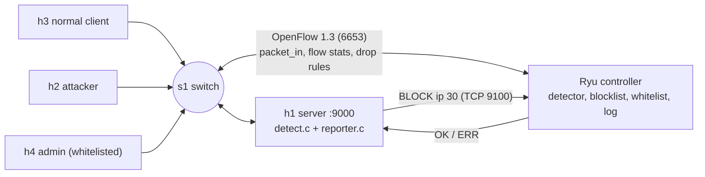

# Architecture

## Components

| Component | Where | Language | Role |
|---|---|---|---|
| Normal clients (h3) and attacker (h2) | Mininet hosts | C (`client`) | Generate normal, burst and bad-login TCP traffic |
| Admin host (h4) | Mininet host | C (`client`) | Whitelisted host, must never be blocked |
| Server (h1, 10.0.0.1:9000) | Mininet host | C (`server`, `detect.c`, `reporter.c`) | Multi-client TCP server, counts failed logins per IP, reports blocks |
| Switch (s1) | Open vSwitch | n/a | Forwards traffic, enforces drop rules |
| Controller (10.0.0.254, OpenFlow port 6653, helper port 9100) | Ryu | Python | Counts connections, polls flow stats, keeps blocklist and whitelist, installs and removes drop rules, logs events |

## Diagram

## Communication flow

**Path A: application signal (failed logins)**
1. A client sends `LOGIN admin <wrong>` to the server.
2. The server replies `FAIL` and counts it for that source IP.
3. At 5 failures within 10 s, the server sends `BLOCK <ip> 30` to the controller (TCP 9100).
4. The controller checks the whitelist, installs a drop rule on `s1`, and replies `OK`
   (or `ERR whitelisted`).

**Path B: network signal (connection rate)**
1. Each new TCP connection has no matching flow on the switch, so `s1` sends a `packet_in`
   to the controller.
2. The controller counts new connections per source IP and also polls flow statistics.
3. At 15 or more new connections within 5 s, the controller blocks the host itself.

**Expiry:** the drop rule has a 30 s `hard_timeout`. The switch removes it, notifies the
controller, and the controller logs the unblock.

## Message formats

| Message | Direction | Reply |
|---|---|---|
| `LOGIN <user> <pass>` | client to server | `OK` or `FAIL` |
| `ECHO <text>` | client to server | `ECHO <text>` |
| `QUIT` | client to server | `BYE` |
| `BLOCK <ip> <seconds>` | server to controller | `OK` or `ERR <reason>` |

## Expected network behaviour
- Normal clients connect and log in without interruption.
- An attacker crossing either threshold loses connectivity to the server within a few
  seconds.
- Other hosts are unaffected while the attacker is blocked.
- After 30 s the attacker can connect again.
